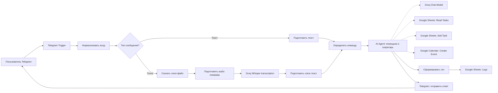

<div align="center">

# 🏗️ Архитектура проекта

## 🤖 Telegram AI Secretary Bot


</div>

---

## 📌 Назначение workflow

Workflow создан в **n8n Cloud** для Telegram-бота, который работает как AI-секретарь.

Основная задача workflow:

```text
Принять текстовое или голосовое сообщение из Telegram
↓
Подготовить сообщение для AI-агента
↓
Обработать запрос пользователя
↓
При необходимости использовать Google Sheets или Google Calendar
↓
Отправить ответ обратно в Telegram
```

---

## 🧩 Общая схема архитектуры



---

## 🔁 Основные этапы обработки

## 1. 📲 Telegram Trigger

Workflow начинается с ноды:

```text
Telegram Trigger: новое сообщение
```

Она срабатывает, когда пользователь отправляет боту сообщение.

Поддерживаемые типы сообщений:

- 💬 текст;
- 🎙️ голосовое сообщение.

На этом этапе workflow получает данные Telegram:

```text
chat_id
user_id
username
message text
voice file_id
timestamp
```

---

## 2. 🧹 Нормализация входа

Следующий этап приводит входящие данные к единому формату.

Нода:

```text
Нормализовать вход
```

создаёт удобную структуру, с которой дальше работают остальные ноды.

Пример внутренних полей:

```text
chat_id
user_id
username
input_type
text
voice_file_id
```

Зачем это нужно:

- текст и голос приводятся к единой логике;
- AI Agent получает понятный input;
- логи в Google Sheets заполняются одинаково;
- workflow проще поддерживать и отлаживать.

---

## 3. 🔀 Определение типа сообщения

После нормализации workflow определяет, что пришло от пользователя.

Нода:

```text
Тип сообщения — голос?
```

разделяет поток на две ветки:

```text
TRUE  → голосовое сообщение
FALSE → не голосовое сообщение
```

Также есть проверка текстового сообщения:

```text
Тип сообщения — текст?
```

Это позволяет отдельно обработать голос и текст, а затем снова объединить их перед AI Agent.

---

# 💬 Ветка текстовых сообщений

Если пользователь отправил текст, workflow идёт по простой ветке:

```text
Telegram Trigger
↓
Нормализовать вход
↓
Тип сообщения — текст?
↓
Подготовить текст
↓
Определить команду
↓
AI Agent
```

Нода подготовки текста формирует единое поле с сообщением пользователя, которое затем передаётся AI-агенту.

Пример входа:

```text
Добавь задачу: подготовить презентацию к 4 сентября 2026, приоритет высокий.
```

---

# 🎙️ Ветка голосовых сообщений

Если пользователь отправил voice message, workflow проходит дополнительные шаги.

## 1. 📥 Скачать voice-файл

Нода:

```text
Telegram: скачать voice-файл
```

получает аудиофайл из Telegram по `file_id`.

Telegram voice обычно приходит в формате `.oga/.ogg`, поэтому перед отправкой в транскрибацию нужно корректно подготовить metadata.

---

## 2. 🛠️ Подготовить audio metadata

Нода:

```text
Подготовить audio metadata
```

устанавливает корректные параметры файла:

```text
fileName: voice.ogg
fileExtension: ogg
mimeType: audio/ogg
```

Это нужно для стабильной отправки файла в Groq Whisper API.

---

## 3. 🎧 Groq Whisper transcription

Нода:

```text
Groq: расшифровать голос
```

отправляет аудиофайл в Groq Whisper через HTTP Request.

Используется endpoint:

```text
POST https://api.groq.com/openai/v1/audio/transcriptions
```

Тело запроса отправляется как multipart form-data:

```text
file      → binary audio file
model     → whisper-large-v3-turbo
language  → ru
```

На выходе Groq возвращает распознанный текст.

---

## 4. 📝 Подготовить voice-текст

После расшифровки workflow приводит результат к тому же формату, что и обычный текст.

Нода:

```text
Подготовить voice-текст
```

формирует сообщение для AI Agent.

Таким образом, дальше workflow уже не имеет значения, пришёл текст напрямую или был получен из голосового сообщения.

---

# 🧠 Определение команды

Перед передачей в AI Agent workflow определяет тип пользовательского запроса.

Нода:

```text
Определить команду
```

помогает понять, относится ли сообщение к одной из категорий:

- обычный диалог;
- добавление задачи;
- чтение списка задач;
- планирование встречи;
- запрос совета или помощи.

Для календарных команд дополнительно отмечается флаг:

```text
calendar_command = yes/no
```

Этот флаг затем используется для логирования.

---

# 🤖 AI Agent

Центральная нода workflow:

```text
AI-агент: помощник и секретарь
```

AI Agent получает подготовленный текст и выполняет роль секретаря.

## Роль агента

```text
AI-помощник и секретарь, который помогает пользователю структурировать задачи, планировать встречи, давать краткие советы и дружелюбно общаться.
```

## Поведение агента

Агент должен:

- отвечать дружелюбно и кратко;
- помогать формулировать задачи;
- добавлять задачи в Google Sheets;
- читать список задач из Google Sheets;
- создавать встречи в Google Calendar;
- не использовать Markdown-таблицы для Telegram;
- форматировать задачи списком, удобным для чтения.

---

# ⚡ Groq Chat Model

К AI Agent подключена языковая модель через Groq.

Нода:

```text
Groq Chat Model
```

используется для генерации ответов AI-ассистента.

Связь с AI Agent выполнена через вход:

```text
Chat Model
```

Это позволяет агенту понимать пользовательские команды и вызывать нужные инструменты.

---

# 🧠 Память диалога

К AI Agent подключена нода:

```text
Память диалога
```

Это window buffer memory: короткий контекст последних реплик, чтобы агент не терял нить разговора внутри сессии.

---

# 📊 Google Sheets

Google Sheets используется в двух направлениях:

1. ✅ хранение задач;
2. 🧾 логирование диалогов.

---

## ✅ Лист Tasks

Лист `Tasks` хранит задачи пользователя.

Структура:

```text
created_at
chat_id
task
priority
deadline
status
```

Пример команды:

```text
Добавь задачу: подготовить презентацию к 4 сентября 2026, приоритет высокий.
```

AI Agent извлекает задачу, срок и приоритет, затем добавляет запись в Google Sheets.

---

## 📋 Чтение задач

Пользователь может спросить:

```text
Какие задачи у меня сохранены?
```

AI Agent использует Google Sheets tool для чтения листа `Tasks` и возвращает список задач в Telegram.

Ответ форматируется не таблицей, а удобным списком.

Пример формата:

```text
📋 Список задач

1. 📝 Подготовить презентацию
   ⚡ Приоритет: высокий
   📅 Срок: 04.09.2026
   📌 Статус: новый
```

---

## 🧾 Лист Logs

Лист `Logs` хранит историю взаимодействий.

Структура:

```text
timestamp
chat_id
user_id
username
input_type
user_message
assistant_reply
calendar_command
```

В лог попадают:

- текстовые сообщения;
- голосовые сообщения;
- распознанный текст голосового сообщения;
- ответ AI Agent;
- признак календарной команды.

---

# 🗓️ Google Calendar

Google Calendar подключён как инструмент AI Agent.

Нода:

```text
Google Calendar: создать встречу
```

используется, когда пользователь просит запланировать встречу.

Пример команды:

```text
Запланировать встречу: обсуждение проекта 5 сентября 2026 в 15:00 на 30 минут.
```

AI Agent извлекает:

```text
summary / название встречи
start / дата и время начала
end / дата и время окончания
```

После этого событие создаётся в календаре, а пользователю отправляется подтверждение в Telegram.

---

# 📩 Ответ в Telegram

Финальный этап workflow — отправка результата пользователю.

Нода:

```text
Telegram: отправить ответ
```

отправляет сообщение обратно в тот же Telegram chat.

Ответы адаптированы под Telegram:

- короткие абзацы;
- списки;
- эмодзи для читаемости;
- без Markdown-таблиц;
- без сложного форматирования.

---

# 🧾 Логирование результата

После обработки сообщения workflow формирует запись для Google Sheets.

Нода:

```text
Сформировать лог
```

собирает данные:

```text
кто написал
когда написал
какой тип сообщения
что написал пользователь
что ответил ассистент
была ли календарная команда
```

Затем запись отправляется в Google Sheets:

```text
Google Sheets: лог диалога
```

---

# 🔄 Полные сценарии обработки

## 💬 Сценарий 1: текстовое сообщение

```text
Пользователь отправляет текст
→ Telegram Trigger
→ Нормализовать вход
→ Проверка типа сообщения
→ Подготовить текст
→ Определить команду
→ AI Agent
→ При необходимости Google Sheets / Calendar
→ Логирование
→ Ответ в Telegram
```

---

## 🎙️ Сценарий 2: голосовое сообщение

```text
Пользователь отправляет голос
→ Telegram Trigger
→ Нормализовать вход
→ Проверка типа сообщения
→ Скачать voice-файл
→ Подготовить audio metadata
→ Groq Whisper transcription
→ Подготовить voice-текст
→ Определить команду
→ AI Agent
→ При необходимости Google Sheets / Calendar
→ Логирование
→ Ответ в Telegram
```

---

## ✅ Сценарий 3: добавление задачи

```text
Пользователь просит добавить задачу
→ AI Agent определяет задачу, срок и приоритет
→ GoogleSheets_Add_Task
→ Задача сохраняется в Tasks
→ Ответ пользователю
→ Запись в Logs
```

---

## 📋 Сценарий 4: чтение задач

```text
Пользователь спрашивает список задач
→ AI Agent вызывает GoogleSheets_Read_Tasks
→ Получает задачи из Google Sheets
→ Формирует понятный список
→ Отправляет ответ в Telegram
→ Записывает обращение в Logs
```

---

## 🗓️ Сценарий 5: создание встречи

```text
Пользователь просит запланировать встречу
→ AI Agent извлекает название, дату, время и длительность
→ Google Calendar Create Event
→ Событие появляется в календаре
→ Пользователь получает подтверждение
→ Запись сохраняется в Logs
```

---

# 🧪 Проверенные результаты

Workflow был проверен на следующих сценариях:

| Сценарий | Результат |
|---|---|
| 💬 Текстовое сообщение | ✅ Бот отвечает |
| 🎙️ Голосовое сообщение | ✅ Бот расшифровывает и отвечает |
| ✅ Добавление задачи | ✅ Задача появляется в Google Sheets |
| 📋 Чтение задач | ✅ Бот выводит список задач |
| 🗓️ Создание встречи | ✅ Событие создаётся в Google Calendar |
| 🧾 Логирование текста | ✅ Запись появляется в Logs |
| 🧾 Логирование голоса | ✅ Запись появляется в Logs |
| 🚀 Published workflow | ✅ Бот работает в production-режиме |

---

# 🛠️ Что было отлажено в процессе

Во время разработки были решены реальные проблемы интеграций:

- ⚠️ ошибка Telegram webhook в тестовом режиме;
- ⚠️ отсутствие баланса OpenAI и замена транскрибации на Groq Whisper;
- ⚠️ настройка Groq Chat Model вместо OpenAI Chat Model;
- ⚠️ конфликт одинаковых имён Google Sheets tools;
- ⚠️ ошибка Google Calendar ID;
- ⚠️ некрасивое отображение Markdown-таблиц в Telegram;
- ⚠️ проблема формата Telegram voice-файла `.oga/.ogg`;
- ⚠️ необходимость подготовки audio metadata перед Groq Whisper.

---

# 🔐 Безопасность архитектуры

Публичная версия проекта не содержит секретных данных.

Не публикуются:

```text
Telegram Bot Token
Groq API Key
Google OAuth credentials
Google Sheet private links
Google Calendar private links
n8n credentials
production workflow JSON with secrets
```

Также ссылка на активного Telegram-бота не публикуется в открытом доступе, чтобы посторонние пользователи не могли использовать рабочий бот.

---

# 📸 Скриншоты (как в репозитории)

| Файл | Что на кадре |
|---|---|
| `screenshots/01-workflow-overview.jpg` | Editor, Published, полный граф нод |
| `screenshots/02-workflow-execution.jpg` | Executions: успешный прогон |
| `screenshots/03-telegram-add-task.jpg` | Telegram: приветствие + add task |
| `screenshots/04-telegram-tasks-meeting.jpg` | Telegram: список задач + встреча |
| `screenshots/05-telegram-voice.jpg` | Telegram: ответы на voice |
| `screenshots/06-google-sheets-tasks.jpg` | Лист `Tasks` |
| `screenshots/07-google-sheets-logs.jpg` | Лист `Logs` (задачи / календарь) |
| `screenshots/08-google-sheets-logs-voice.jpg` | Лист `Logs` (text + voice) |
| `screenshots/09-google-calendar.jpg` | Событие «обсуждение проекта» |

# 📁 Структура репозитория

```text
Telegram_AI_Secretary-N8N/
├── README.md
├── ARCHITECTURE.md
├── LICENSE
└── screenshots/
    ├── 01-workflow-overview.jpg
    ├── 02-workflow-execution.jpg
    ├── 03-telegram-add-task.jpg
    ├── 04-telegram-tasks-meeting.jpg
    ├── 05-telegram-voice.jpg
    ├── 06-google-sheets-tasks.jpg
    ├── 07-google-sheets-logs.jpg
    ├── 08-google-sheets-logs-voice.jpg
    └── 09-google-calendar.jpg
```

---

# ✅ Итог

Проект реализует Telegram AI-секретаря, который:

- 💬 принимает текст;
- 🎙️ принимает голос;
- 🧠 расшифровывает голос через Groq Whisper;
- 🤖 использует AI Agent для обработки запросов;
- ✅ работает с задачами в Google Sheets;
- 🧾 логирует диалоги;
- 🗓️ создаёт встречи в Google Calendar;
- 📩 отправляет ответы обратно в Telegram;
- 🧩 имеет понятную структуру workflow с подписанными нодами и комментариями.
