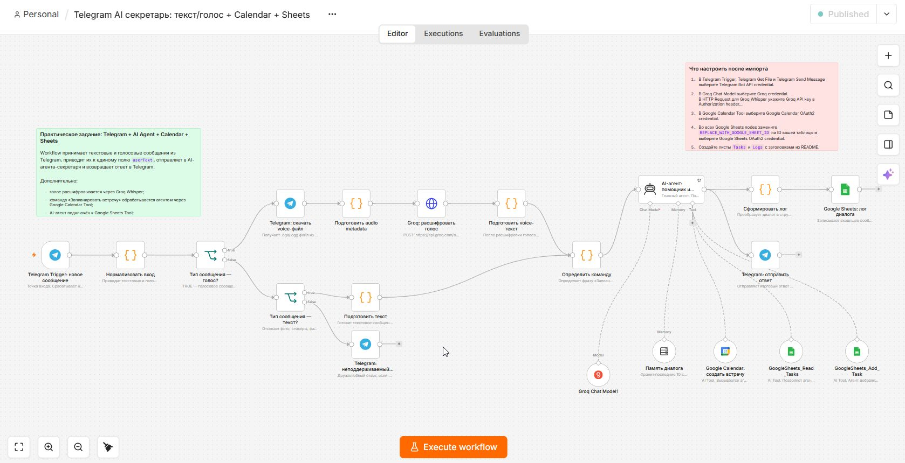
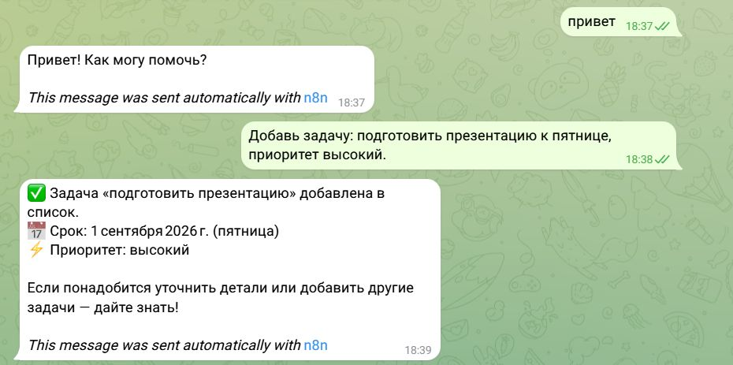
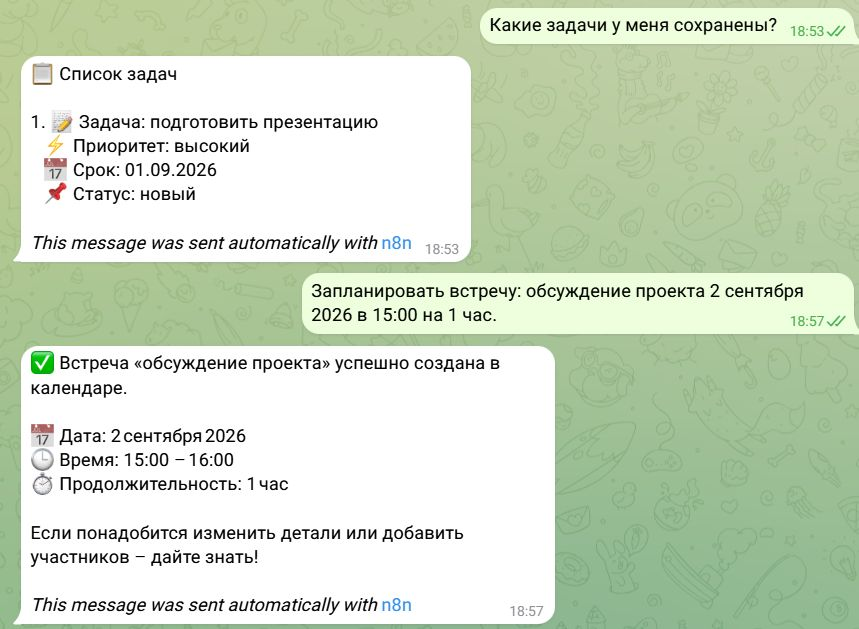
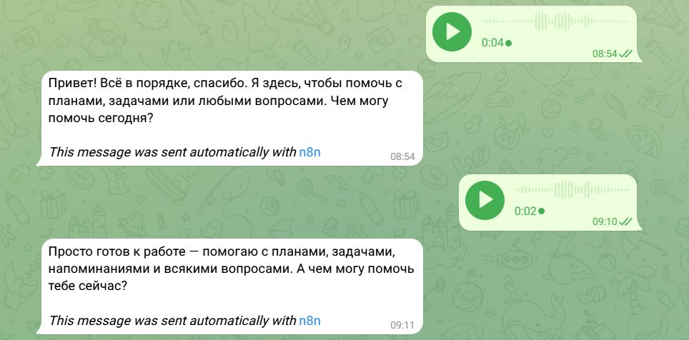
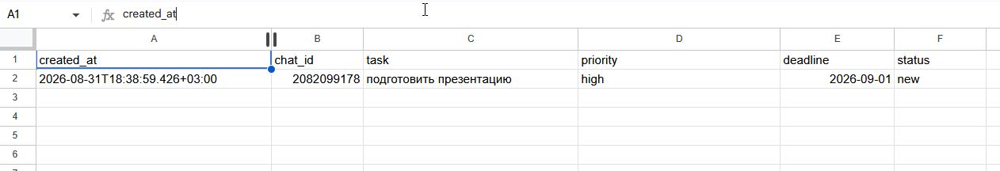
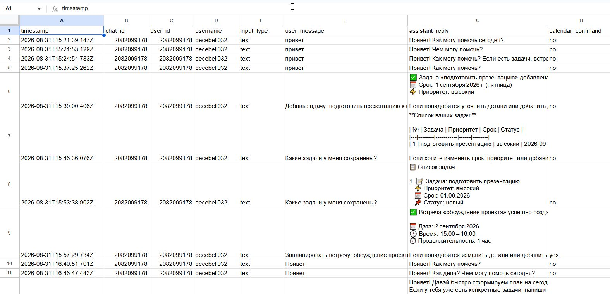
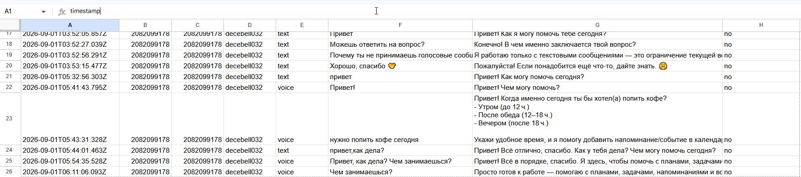
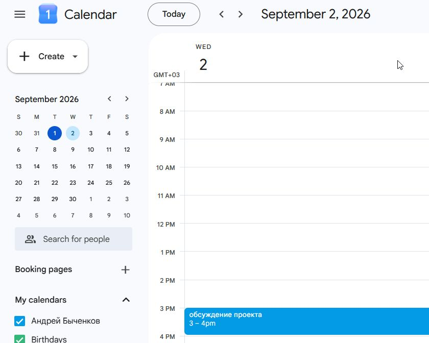
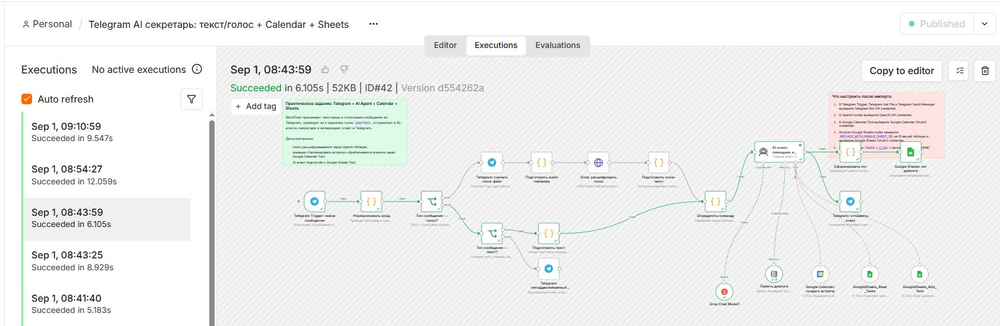
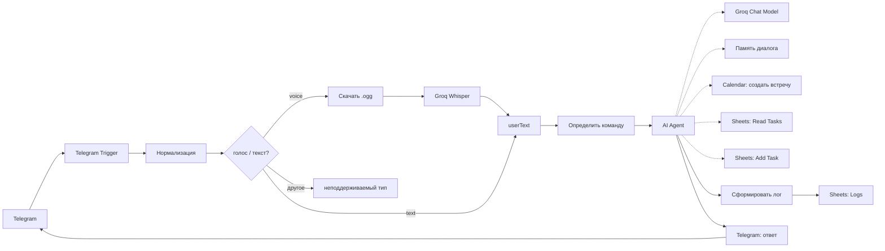

<div align="center">

# Telegram AI Secretary

### n8n · Groq · Whisper · Google Sheets · Google Calendar

AI-секретарь в Telegram: текст и голос, задачи в таблицах, встречи в календаре.

[](https://n8n.io)
[](https://telegram.org)
[](https://groq.com)
[](https://workspace.google.com)
[](./LICENSE)

<br/>



<sub>Production workflow в n8n Cloud · статус Published</sub>

</div>

---

## Зачем это

Портфолио-проект: end-to-end автоматизация личного секретаря без отдельного бэкенда.

Пользователь пишет или говорит в Telegram → workflow нормализует вход → Groq Whisper расшифровывает голос → AI Agent решает, что делать → Google Sheets / Google Calendar → ответ обратно в чат.

Исходный JSON workflow, токены и credentials **в репозиторий не входят**. Здесь архитектура, сценарии и живые скриншоты.

---

## Стек

| | |
|---|---|
| **n8n Cloud** | оркестрация, AI Agent, tools, memory |
| **Telegram Bot API** | текст, voice, ответы в тот же chat |
| **Groq Chat Model** | генерация ответов агента |
| **Groq Whisper** (`whisper-large-v3-turbo`) | транскрибация `.ogg` / `.oga` |
| **Google Sheets** | лист `Tasks` + лист `Logs` |
| **Google Calendar** | создание событий по NL-команде |
| **Window Buffer Memory** | короткий контекст диалога |

---

## Что умеет бот

<table>
<tr>
<td width="50%" valign="top">

**Текст**

```text
привет
```

```text
Привет! Чем могу помочь?
```

**Задача**

```text
Добавь задачу: подготовить презентацию
к пятнице, приоритет высокий.
```

Агент сам достаёт title / deadline / priority и пишет строку в `Tasks`.

</td>
<td width="50%" valign="top">

**Список**

```text
Какие задачи у меня сохранены?
```

Ответ списком под Telegram, без markdown-таблиц.

**Встреча**

```text
Запланировать встречу: обсуждение проекта
2 сентября 2026 в 15:00 на 1 час.
```

Событие появляется в Google Calendar, в чат уходит подтверждение.

</td>
</tr>
</table>

**Голос:** Telegram voice → скачать файл → metadata `audio/ogg` → Groq Whisper (`language=ru`) → тот же пайплайн, что и у текста.

---

## Демо

### Telegram — задачи и встречи

<table>
<tr>
<td width="50%" align="center">

<br/>
<sub>Приветствие + добавление задачи</sub>
</td>
<td width="50%" align="center">

<br/>
<sub>Список задач + создание встречи</sub>
</td>
</tr>
</table>

### Telegram — голос

<p align="center">
  
</p>

<p align="center"><sub>Voice-сообщения → Whisper → ответ агента</sub></p>

### Google Sheets

<table>
<tr>
<td width="50%" align="center" valign="top">

<br/>
<sub><b>Tasks</b> — created_at, chat_id, task, priority, deadline, status</sub>
</td>
<td width="50%" align="center" valign="top">

<br/>
<sub><b>Logs</b> — диалоги, input_type, calendar_command</sub>
</td>
</tr>
</table>

<p align="center">
  
</p>

<p align="center"><sub>В логах отдельно видны text и voice</sub></p>

### Google Calendar

<p align="center">
  
</p>

<p align="center"><sub>«обсуждение проекта» · 2 сентября 2026 · 15:00–16:00</sub></p>

### n8n — execution

<p align="center">
  
</p>

<p align="center"><sub>Executions: успешный прогон, ветки текст/голос, tools агента</sub></p>

---

## Архитектура



Полный разбор нод, полей и сценариев: **[ARCHITECTURE.md](./ARCHITECTURE.md)**.

---

## Поток данных

```text
Telegram Trigger
        │
        ▼
 Нормализовать вход          chat_id / user_id / username / input_type / text / voice_file_id
        │
        ├── voice ──► download ──► audio metadata ──► Groq Whisper ──► userText
        ├── text  ──► подготовить текст ──────────────────────────────► userText
        └── else  ──► «неподдерживаемый тип»
        │
        ▼
 Определить команду          в т.ч. calendar_command = yes/no
        │
        ▼
 AI Agent                    Groq + memory + Sheets + Calendar
        │
        ├──► Google Sheets: лог диалога
        └──► Telegram: отправить ответ
```

---

## Схемы таблиц

**Tasks**

| created_at | chat_id | task | priority | deadline | status |
|---|---|---|---|---|---|
| ISO-8601 | Telegram chat | описание | high / … | YYYY-MM-DD | new |

**Logs**

| timestamp | chat_id | user_id | username | input_type | user_message | assistant_reply | calendar_command |
|---|---|---|---|---|---|---|---|
| ISO-8601 | id | id | @user | text / voice | вход | ответ агента | yes / no |

---

## Что реально проверено

| Сценарий | Статус |
|---|---|
| Текст → ответ в Telegram | ✅ |
| Voice → Whisper → ответ | ✅ |
| Добавление задачи в Sheets | ✅ |
| Чтение списка задач | ✅ |
| Событие в Google Calendar | ✅ |
| Лог текста и голоса | ✅ |
| Workflow Published | ✅ |

По дороге отлажено (не теория): webhook в test-mode, замена OpenAI → Groq (модель + Whisper), конфликт имён Google Sheets tools, Calendar ID, markdown-таблицы в Telegram, metadata для `.oga/.ogg`.

---

## Чего нет в репозитории — намеренно

Публичная версия **без основного кода** (без export JSON) и без секретов:

- Telegram Bot Token
- Groq API Key
- Google OAuth / Sheet ID / Calendar ID
- n8n credentials
- ссылка на живого бота

Демо бота — только лично по запросу.

Это не one-click deploy. Чтобы собрать свой экземпляр, нужны собственные ключи, n8n Cloud и таблицы `Tasks` / `Logs`.

---

## Структура

```text
Telegram_AI_Secretary-N8N/
├── README.md
├── ARCHITECTURE.md
├── LICENSE
└── screenshots/
    ├── 01-workflow-overview.jpg
    ├── 02-workflow-execution.jpg
    ├── 03-telegram-add-task.jpg
    ├── 04-telegram-tasks-meeting.jpg
    ├── 05-telegram-voice.jpg
    ├── 06-google-sheets-tasks.jpg
    ├── 07-google-sheets-logs.jpg
    ├── 08-google-sheets-logs-voice.jpg
    └── 09-google-calendar.jpg
```

---

## Автор

**Andrey Bychenkov** · [GitHub](https://github.com/AndreyBychenkow)

Copyright © 2026. All rights reserved. См. [LICENSE](./LICENSE).
